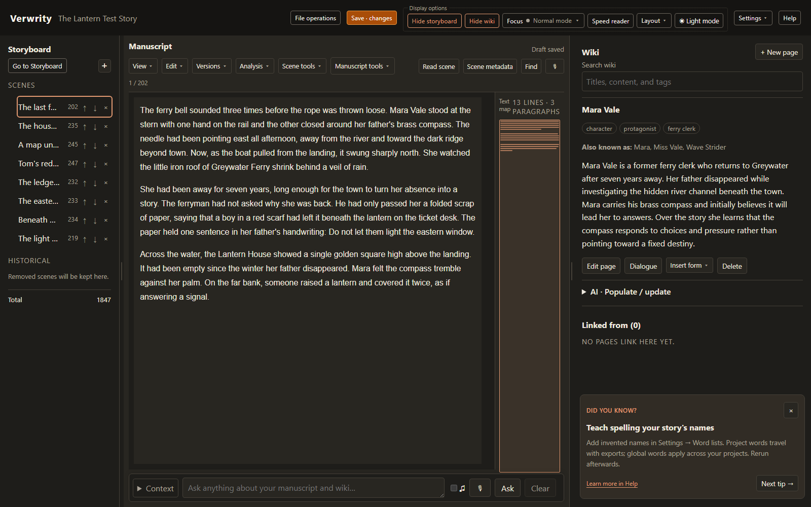

# Verwrity

**[Support my work on Buy Me a Coffee](https://buymeacoffee.com/dkjroot)**

## What is Verwrity?

Verwrity is a complete writer's workbench with a manuscript editor, storyboard, a wiki for your memories and notes, and a lot of powerful editing features. 

It runs on your computer, and you can run all the AI-enhanced features on your own computer (or not use them at all!)

While Verwrity includes powerful AI editing tools, it is *NOT AN AI WRITER*.  It will never write your manuscript for you. If that's what you're after, look elsewhere! With Verwrity, you are the writer, and your work is 100% a result of your human creativity. That said, AI used the right way can be really useful in helping you keep track of your story and helping polish your prose. That's how AI is used in Verwrity, for good not evil - it's a useful tool when it's used responsibly.

The most important thing to me is that your writing belongs to you. If you use the AI tools, their suggestions are just suggestions. **The AI will never write a word of your manuscript for you**. And any original work you write using Verwrity is your property, always.


### Goals

Verwrity is under active development.  The goals are:

* The most powerful suite of creator-focussed writing and world-building tools ever made.
* Total privacy. Verwrity runs locally on your computer, using local AI if you choose to use those features. No internet connection is required.
* Using Internet APIs is possible if you choose. It's made very clear when you do that. The default is always offline.
* No AI writing in your manuscript, ever!
* Completely free to use, unless you choose to support further development through optional contributions.

### Features

* Clean editing UI. It's not a word processor or publishing typesetter, it's a text editor.
* Focus modes to remove distractions, including "typewriter focus" where you can't edit backwards... great for habitual revisers!
* A storyboard mode to help you organise your scenes and track aspects of your story/character arcs.
* A built-in wiki to store all your memories for easy recall. Words that match a wiki page are highlighted in your manuscript for quick access.
* Save 'versions' of your scenes in a simplified git-style edit history.
* "Ask the AI" about your manuscript.  'What colour hat did I say Benny was wearing?'
* AI line editing tools help you find grammar flaws, clichés, weak descriptions, mixed tenses etc. You can even define your own analysis modes.
* Speech to text in manusctript and wiki editors - if you prefer to talk rather than type.
* Text to Speech, if you want to hear your manuscript read out loud (it's a good idea to hear your prose aloud... you should read it aloud too!)
* Dictation mode - a deeper speech to text feature (I write my first drafts by hand, then read them out loud to get them into Verwrity).
* OCR input - if you like to use a real typewriter, you can make a video of the pages and Verwrity will pick out stills and convert them to text.
* Speed reader mode - a bit of fun, train your reading speed by reading your manuscript in a speed reading focus view.


### Free to use. Please help keep it that way.

I develop this project to be freely available to everyone, supported, if at all, by voluntary contributions. I do not want other people to profit from my work by selling copies, putting it behind a paywall, or building a paid application or hosted service around it. I ask you to respect that intention: please keep this work freely available, credit its origins, and direct people to [my official GitHub repository](https://github.com/dkjroot/verwrity) for the software.

If you want to help fund my development, please contribute **directly to me** through [Buy Me a Coffee](https://buymeacoffee.com/dkjroot). Paying a distributor or hosting provider does not fund my work unless I explicitly say otherwise. There is no obligation to contribute.

**This is a personal request, not an additional license restriction.** The legal permissions stated in the [GNU General Public License v3.0](license.txt) remain unchanged by this request. See [licensing details](LICENSING.md) and [third-party credits](THIRD_PARTY_NOTICES.txt).

**Your writing belongs to you.** This request concerns Verwrity itself, not the works you create with it. Using Verwrity does not put your manuscript, wiki, project files, or exports under GPL. You may keep your work private, publish it, choose its license, and sell it without paying me or releasing its source. Rights in any third-party material you include remain separate.

### Lets make Verwrity a writer's community!

Please let me know if you use Verwrity to write something you're proud of. Currently you can contact me by raising an 'issue' on the github project, or via buymeacoffee. My github page includes a link to my bluesky and my youtube channel. 

I'd love to read your work, and if you use it to work on a piece that gets published I'd really get a kick out of hearing about it, and I'll probably buy a copy of your book!

If there's enough of us, we could start a subreddit or something :)

## Using Verwrity

[Run locally](#run-locally) · [Writing tools](#writing-tools) · [User guides](#user-guides) · [Privacy](#privacy-and-optional-ai) · [Saving and recovery](#saving-and-recovery)



*A fictional story created for the user guide.*

## Still under development

Please save often and keep backups. I try to keep old projects compatible, but while Verwrity is still in early development, bugs and changes are possible. Download a plain-text manuscript backup regularly, as well as the full project archive, and keep a copy somewhere safe. Your writing is the bit that matters. Make sure you keep it safe!

## Run locally

You need Python 3.11 or newer. Download or clone this repository, open a terminal in its folder, and install it using the commands for your system (below). You don't need a local AI model or any kind of paid API account just to write. And of course, Verwrity itself is totally free.  Remember, you own what you write - we make no claim on your writing, and Verwrity will never send your text over the internet without your permission. If you configure a remote AI API, that's the only time your text will leave your computer, and that is disabled by default.

### Windows PowerShell

Set up the environment once:

```powershell
py -3 -m venv venv
.\venv\Scripts\python.exe -m pip install -e .
.\run.cmd
```

After that, double-click **run.cmd** in Explorer, or run `.\run.cmd` from PowerShell. It uses the project's environment and starts in the correct folder.

If you want any of the optional features below, stop the server with **Ctrl+C**, then run the command for the feature you want from the project folder. You can install more than one, but you don't need to install everything just to write!

| If you want… | Run this in PowerShell |
|---|---|
| Local text-to-speech with Kokoro, using your CPU | `.\venv\Scripts\python.exe -m pip install -e ".[local-tts]"` |
| Local text-to-speech with Kokoro, using an NVIDIA GPU instead | `.\venv\Scripts\python.exe -m pip install -e ".[local-tts-cuda]"` |
| Microsoft's online Edge text-to-speech | `.\venv\Scripts\python.exe -m pip install -e ".[remote-tts]"` |
| Local speech recognition with Faster Whisper | `.\venv\Scripts\python.exe -m pip install -e ".[local-stt]"` |
| Importing audio files into Dictate draft | `.\venv\Scripts\python.exe -m pip install -e ".[audio-import]"` |
| Local OCR, including photo and video import | `.\venv\Scripts\python.exe -m pip install -e ".[local-ocr]"` |
| Importing photos and video for an online OCR service | `.\venv\Scripts\python.exe -m pip install -e ".[ocr-import]"` |

Start Verwrity again with `.\run.cmd` when you've finished. See [Setting up the optional features](#setting-up-the-optional-features) below for the model downloads and settings you'll need next.

### Linux, macOS or WSL

```sh
python3 -m venv venv
venv/bin/python -m pip install -e .
venv/bin/python -m verwrity.web.app
```

On later visits, run the last command from the project folder.

For optional features, stop the server with **Ctrl+C** and run whichever commands you need from the project folder:

| If you want… | Run this in your terminal |
|---|---|
| Local text-to-speech with Kokoro, using your CPU | `venv/bin/python -m pip install -e '.[local-tts]'` |
| Local text-to-speech with Kokoro, using an NVIDIA GPU instead | `venv/bin/python -m pip install -e '.[local-tts-cuda]'` |
| Microsoft's online Edge text-to-speech | `venv/bin/python -m pip install -e '.[remote-tts]'` |
| Local speech recognition with Faster Whisper | `venv/bin/python -m pip install -e '.[local-stt]'` |
| Importing audio files into Dictate draft | `venv/bin/python -m pip install -e '.[audio-import]'` |
| Local OCR, including photo and video import | `venv/bin/python -m pip install -e '.[local-ocr]'` |
| Importing photos and video for an online OCR service | `venv/bin/python -m pip install -e '.[ocr-import]'` |

Start Verwrity again with `venv/bin/python -m verwrity.web.app` when you've finished. The CUDA options are for a supported NVIDIA setup on Windows or Linux; they aren't for a Mac's graphics processor. On WSL, you also need working NVIDIA GPU access from inside WSL.

### Setting up the optional features

Installing a package gives Verwrity the software it needs to use that feature. For local speech and OCR, you'll also need the model files. Open **Settings → AI Models**, choose the feature and provider you want, and use its download controls or point it at files you've already downloaded. Those downloads need an internet connection during setup; using the local models afterwards doesn't send your writing, recordings or page images online.

Choose either the CPU or CUDA package for Kokoro. CUDA needs compatible NVIDIA drivers and libraries, and local OCR may need a separate GPU-enabled PyTorch installation. These models can be large and need a capable computer, particularly for OCR; the [feature reference](user-guides/REFERENCE.md#ai-and-speech-capabilities) has the fuller setup and troubleshooting instructions. Local OCR includes photo/video import, and local speech recognition includes the audio decoder, so you don't need their separate import packages as well.

You don't need an extra package to connect a text model through a supported HTTP API, or to use an online speech recognition service. For LLM tools you'll need to run a local model server or set up your online provider's details, and possibly an API key. Edge TTS needs no key, but it is still an online service that receives the text you ask it to read. Verwrity asks for permission before using remote services.

### Open the workspace

Open [Verwrity on this computer](http://127.0.0.1:8000) in your browser. Leave the server running while you write. When you're done you can stop it with **Ctrl+C** in its terminal. Always start from the project folder so Verwrity finds your saved files.

Verwrity is pretty good at re-establishing a connection if you stop and start the server, and it saves drafts if you forget to save, but you should save often with Ctrl+S (and like I said earlier, during early development of this project, export your manuscript occasionally for safety, especially before you run git pull to get the latest version).

This is a local application. By default the Verwrity server listens only on this computer, and so you won't be able to connect to the UI from anywhere else, even computers on your own network. There are no user accounts or access controls yet. Don't expose Verwrity's listen port to the internet or a shared network unless you know what you're doing and are content your work will be safe. If you do choose to allow Verwrity to receive incoming connections from the internet, you should update dependencies often to patch security vulnerabilities. I don't guarantee forward compatibility with any new library versions etc. until I've updated the software myself. Basically, I recommend you run it on the same computer you plan to write on!

## Writing tools

- **Manuscript:** supports continuous pages, pagination or two-page spreads, font and colour choices, dark mode, word counts, find/replace and a text map for navigating long scenes. Manuscript prose is saved as plain text; the view options just change how it looks on screen.
- **Storyboard:** for scene ordering, descriptions and other scene metadata, coloured Sticky notes and custom storyboard grid fields. Scene notes let you record what you're trying to do without putting it into the manuscript.
- **Story wiki:** with pages for characters, places, research and plans, with tags, aliases, internal links, search, formatting preview and page history. Wiki notes are separate from the manuscript but stored in a single project file along with the manuscript. The project file is just a zip, you can open it and see the raw text of everything if you want to.
- **Focus and Typewriter modes:** hide distractions and keep your preferred layout. Typewriter mode can lock the caret while you keep writing, so that you are prevented from habitually revising while drafting.
- **Review:** you can save comments, record scene history checkpoints and compare them, check spelling and synonyms and use all kinds of optional AI analysis modes. Dialogue can be linked to character wiki pages and reviewed per speaker, so you can easily check for consistency of tone.
- **Read and dictate:** Verwrity features a read-aloud text-to-speech mode, speech-to-text dictation, long dictation drafts and OCR for photographed or filmed manuscript pages.

The [feature reference](user-guides/REFERENCE.md) goes through the controls, settings and optional installations in more detail. For the newer tools, see [dictation, OCR and speed reading](user-guides/IMPORT-AND-READING.md).

## User guides

Start with [Your first days with Verwrity](user-guides/START-HERE.md) for a practical introduction with screenshots.

The [guide index](user-guides/README.md) helps you find the longer reference or a guide to a particular tool. You don't need to read everything before you start writing.

- [Feature reference](user-guides/REFERENCE.md): settings, AI and speech setup, OCR, project files and recovery.
- [Dialogue and scene operations](user-guides/DIALOGUE_AND_SCENES.md): speaker labels, split/join, history and text backups.

There's also **Help** in the workspace, plus optional tips beside the wiki.

## Privacy and optional AI

Writing and local project storage work without an internet connection. Spelling and the basic thesaurus are local. AI is optional: configure it in **Settings → AI Models** only when you want it.

Local AI models run on your computer. You'll need to download their files during setup; using them offline doesn't download anything else. You will need a powerful computer to run them. A gaming PC is capable of a lot of useful work. I personally have a 24gb 3090 and can run gemma-4-26b gguf on it, and it provides adequate quality for the Verwrity analysis modes. I run most other models on CPU, and if I do any OCR I stop the LLM to free up some VRAM.

If you choose an online service, it receives the text, images or audio needed for the job you've asked it to do, only after you've set up that service in the AI settings menu. Some services need an account, API key or paid usage.

Models can get things wrong. Read their suggestions and check that they've understood what you meant. Your own wiki text stays protected unless you hand over a section for AI management. Wiki text generated by AI is marked as such, with its source details and a warning if it has no verified citation.

Provider settings and API keys stay in local settings under `user_files/` and are excluded from portable projects. Keys are stored in local JSON, so keep that directory private.

Verwrity doesn't send any telemetry or analytics to the internet.  I've tried hard to make sure the libraries I use don't either, but if you want absolute assurance your work is private, you could even disconnect from the internet - Verwrity will still work.

## Saving and recovery

Use **Save project** or **Ctrl+S / Cmd+S** to save your changes. Automatic recovery drafts are saved to help recover working changes, but they aren't a substitute for a named save and backups.

- **Export project** downloads a portable `.verwrity.zip` with your scenes, wiki, comments, history, project words etc. Its human-readable files can be extracted without Verwrity. Your project is saved locally in the Verwrity directory on your computer, so it's safe there, but maybe you want to export it occasionally to save a backup.
- **Manuscript backup → Download .txt** downloads current manuscript prose with scene titles and descriptions. Although your manuscript is in your project zip, you might like to export just the text sometimes.
- **Versions → Record revision** keeps a scene checkpoint for comparison or later restoration. This is a good way to go back and see a previous version of a scene, and could be useful evidence if you ever need to prove the project is your own work! Wiki pages have their own history. When you export your manuscript as text, only the current version of the scenes that are in your project right now are exported. History is in your project zip.

Your project zips and recovery files live under `user_files/local-user/` in the Verwrity directory.  Recovery keeps a current draft and two fallbacks for each project. If a saved project has newer recovery data, Verwrity asks which version to open when you start.

If the server becomes unavailable, keep the browser tab open, restart the server and let the connection dialog recover. Don't refresh a tab with unsaved writing. Retry a failed save once the server is back. See [the recovery reference](user-guides/REFERENCE.md#working-heads-named-saves-and-recovery) for details.

## License

Verwrity's own code is released under the [GNU GPL version 3](license.txt) (`GPL-3.0-only`), with no warranty. Your manuscripts and other original works remain yours: you may keep them private, publish them or sell them.

Third-party components retain their own licenses; see [licensing details](LICENSING.md) and [third-party credits](THIRD_PARTY_NOTICES.txt).
