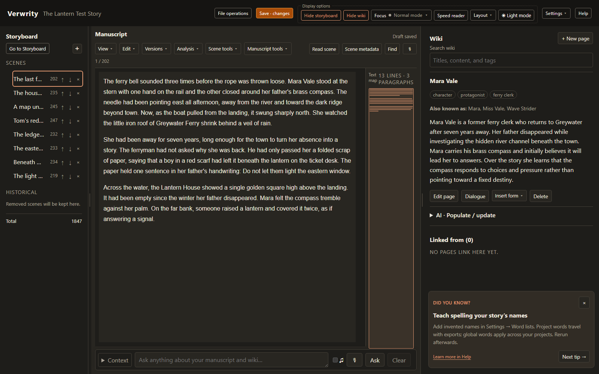
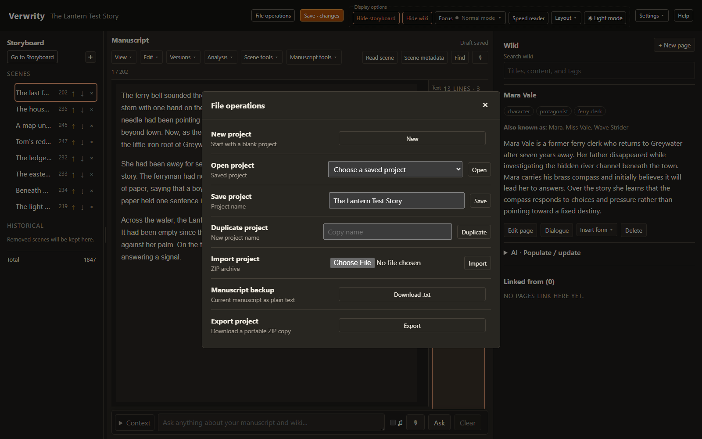
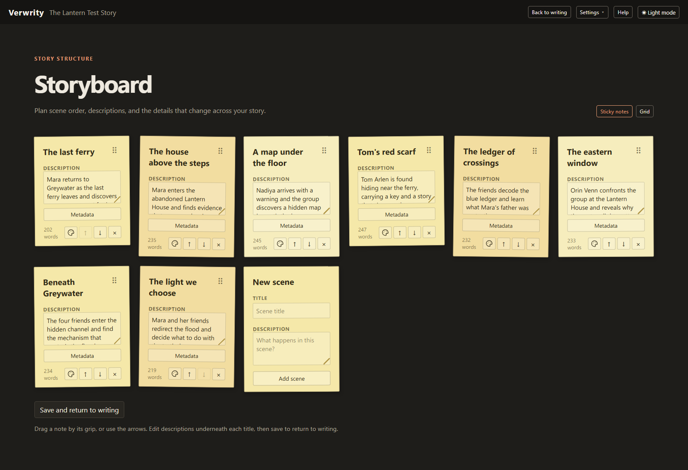
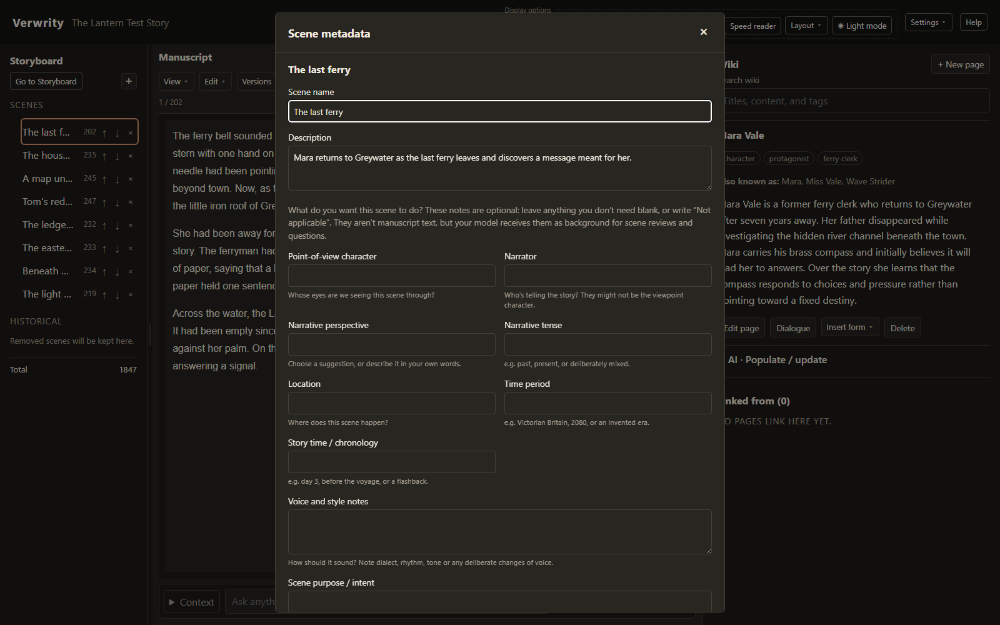

# Your first days with Verwrity

You don't need to use every tool. I suggest you begin with a scene, write a little, and learn the rest when it becomes useful. You could write an entire novel without setting up AI or using the wiki (but I recommend you do learn those features as soon as you're feeling comfortable!)

For more detail about a particular tool, use the [feature reference](REFERENCE.md). The [guide index](README.md) also points to shorter guides for dialogue, dictation, OCR etc. You don't need to read them all before you start.

## 1. Open your writing space

If Verwrity has already been installed, Windows users can double-click **run.cmd**. Leave the server window running while you write. Open [Verwrity on this computer](http://127.0.0.1:8000) in your browser. If you aren't a computer person, maybe ask whoever helps with your computer to follow [the installation instructions](../README.md#run-locally). You only need that setup once, and then you can just run the run.cmd.

In **Open a project**, choose **New project**, give your project a name, and confirm. Verwrity creates a named project and **Scene 1**. Any time you come back to Verwrity, you can **Open** your saved project. 

Verwrity is still in development. I recommend you build a habit of saving and exporting your manuscript and project files regularly for backup purposes, just in case something goes wrong. I don't want you to lose your hard work just because I made a programming mistake!

## 2. Meet the three areas of the main workbench

* The **Storyboard** on the left is your list of scenes.
* The **Manuscript** in the middle is where you write the scene you've selected.
* The **Wiki** on the right is your notebook for people, places, plans, secrets, and facts. I think of it as a 'memory palace', its where you can do your world building.

*The writing workspace. All story material in these pictures was invented for this guide.*

A scene could be a chapter, or a smaller piece of writing. Give scenes names that help you recognise them: “The letter at dawn” is more helpful than “Scene 1”.

Click **Scene metadata** above the editor to change the scene name and description. There are other optional fields you can set if you like. You could start with which character the scene is following and what changes during the scene. Choose **Save metadata** when finished.

Write your actual story content in the centre panel. 

## 3. Write a first scene and save it

1. Click in the manuscript and write a few paragraphs. You can paste existing prose here too (or, once you have it set up, dictate by voice!). Verwrity's manuscript is always plain text, not a richly formatted word processor document, this keeps the file in a completely open format and yours to use as you wish.
2. Pause from your writing a moment and look at the save button. **Draft saved** means Verwrity has kept a recovery copy on this computer, but the button will be orange to show that you have changes that have not been saved to your main project yet.
3. Click the main **Save** button, or press **Ctrl+S** (**Cmd+S** on a Mac), to save your project. The button is orange when changes need saving and green when there are no unsaved changes.
4. Open **File operations**. Under **Export project**, choose **Export** to download a complete portable `.verwrity.zip` copy. Put a copy somewhere separate (I recommend you save backups in multiple places in case your hard drive crashes!). 
5. Open the zip up and look at the contents, so that you can see how safe your work is!
6. Under **Manuscript backup**, choose **Download .txt** for an ordinary readable copy of your current manuscript. This includes scene titles and descriptions, but not your wiki or revision history. That text is in your project zip too, but the manuscript backup is probably cleaner if you just want the manuscript text, for example to print out a copy to give to your beta readers.

*Use Save to update your library copy, Export to save a complete portable project, and Download .txt for a readable manuscript backup. These are separate actions.*

### What comes with the project?

Not everything you see on screen is saved in your project archive:

| What you've been working on | Where it's kept |
| --- | --- |
| Manuscript, wiki, scene notes, comments, revisions, confirmed speaker labels, Project words and optional world records | Your project file. Use Save to save library copy and Export for a portable backup. |
| Wiki AI changes you've applied and speaker suggestions you've accepted | Part of the project too, with their authorship and source details. |
| AI scene findings, question answers and dialogue voice feedback | Temporary results, outside the archive. |
| Dictate draft and OCR review work that hasn't been inserted | Recovery in this browser, outside the archive. |
| API keys, model settings, global dictionary and custom review prompts | Local user settings, outside the archive. You'd have to set these up again if you run Verwrity on another computer. |
| Panel layout and view choices | This browser, not saved in the project archive. |

## 4. Make the page comfortable

Open **Text** to change the typeface, size, text colour, and background colour. Use the theme button at the top for light or dark mode.

Open **View** to choose between **Continuous** or **Pages** modes, paper size, single pages or **Side by side**, and **Fit width** or **Fit height**. Page numbers change when you change the layout. None of this is a permanent part of your manuscript, which is just plain text. It's just about how it's shown on screen.

The narrow **Text map** beside the manuscript shows the shape of the current scene. Click it to move around a long scene. It's just a navigation aid.

For fewer distractions, choose **Focus → Focus Mode**. It gives you a maximized editor with less clutter. Click **Focus** again to leave it. **Typewriter Mode** is an even more extreme focus mode where you can't even go back to edit, so you're forced to work forwards. It does have an **Unlock caret** control that lets you reposition and use undo normally.

If you lose your way, just open the floating **Workspace** control. **Show editor controls**, **Show toolbar**, or **Exit focus** will bring you back to the main screen. **Restore default layout** resets panel sizes and visibility to defaults.

## 5. Build a story out of scenes

Use **+** in the Storyboard panel (left) to add a scene with a title and short description. Click a scene name to work on it. The arrows move it earlier or later in the manuscript. Removing a scene with **×** keeps it under **Historical**, so you can revisit or restore it (or permanently delete it).

To work on planning the whole story, choose **Go to Storyboard**. The sticky notes run left to right, then top to bottom. Drag a note by its handle or use its arrows to change reading order. Edit descriptions and choose scene colours to suit your own writing system. Finish with **Save and return to writing**.

*Use the storyboard to see what each scene contributes.*

The **Grid** view gives each scene a row. Add columns such as “Melanie's character arc”, “Relationship between Jo and Jan”, or “Secrets revealed”. This allows you to track aspects of your story through your scenes.

If you move a scene earlier on the board that changes when the reader encounters it but it doesn't change when the event happened in your fictional world. You have to check transitions, revelations, time references etc. yourself after moving scenes. The grid is good for keeping track of this sort of thing.

## 6. Keep a useful story notebook

Choose **+ New page** in the Wiki and name it after a character, place, object, or topic. Open **Edit page**, write your notes, and choose **Save page**.

For example, create Mara's page and write: “She knows who sent the letter. She hasn't told Ivo.”.

You can add alternative titles, for example if a character is called “Mara Vale” in one passage and “Mara” in another, both links will lead to the same page. You can also add comma-separated tags such as `character` or `location`. You can use **Search wiki** to find pages, and you can also click wiki links in your manuscript text (when you have them showing).

Inside a wiki page you can write `[[Ivo]]` to link to Ivo's page, or `[[Ivo|the keeper]]` to display “the keeper”. A missing link can help you create the missing page. Backlinks show other pages that refer to the current one. The wiki supports forms for creation of common page types, for example **Insert form → Character profile** appends useful writing prompts for creating your character. Inserting a form doesn't replace existing content in the wiki page.

*Metadata is a small planning card. Fill only the fields that help you; the prose remains separate.*

## 7. Revise without losing the earlier draft

Before a substantial rewrite, choose **Versions → Record revision**. That makes a numbered checkpoint of the current scene.

You can select an older revision to read it without editing it, or use **Compare versions** to see two versions side by side. **Copy to new head** brings an older version forward, making it the new 'head', and stores the old head as a revision below it.

Select a passage and right-click to **Add comment**. This allows you to write something like “Does she give away too much here?” without interrupting the prose with a reminder. The 'add TODO' option also puts that comment into a special TODO wiki page. You can 'resolve' a note when you've dealt with it. **Analysis → Comments ⋯ → Review comments** lets you find all your notes for the scene, even if the passage that note was related to has been deleted. You can explicitly attach a detached note to a new selection.

Use **Find** or **Ctrl+F** to search the current scene or **Entire project**. This searches manuscript scenes, but not the wiki or older scene revisions. **Replace** changes the first occurrence in the selected scope; **Replace all** changes all of them. Check the scope and **Match case** before replacing a word to make sure you get the instances you wanted to change.

## 8. Use powerful AI line-editing features

Verwrity doesn't have an always-on spell checker. Instead, spell checking is one of many 'analysis modes'. **Analysis → Spelling** checks the active scene for spelling errors. Click a marked word to put the caret there and correct it. To recognise an invented name, right-click it and choose **Word lists…**. Use **Project Words** for story-specific words and **User words** for words you want recognised in every project. You will have to re-run the spelling analysis after making dictionary changes or editing the scene. The reason for spelling to be handled this way is that you can choose which analysis modes are enabled depending on what type of editing run you're doing. Pressing 're-run analysis' will re-reun the selected analysis modes which may or may not include spell checking.

Right-click a word to open the **Thesaurus**. Expand a meaning ('sense') and choose a synonym to replace the selected word. The basic thesaurus needs no AI or internet.

Other optional AI analysis modes examine the manuscript looking for clichés, usage or grammar issues, 'weak' word choices, mixed use of tense, etc. They always offer explanations and will never edit your manuscript automatically. A character's dialect or your fragment may be exactly right already, so you don't have to accept every recommendation. Think of it as an early line editor to help pick up the easy stuff before you hand your draft over to your human editor. Just keep in mind that AI is not a better writer than you, it doesn't know what you were thinking or what your vision is, and so you should trust your own judgement. Still, it can be very useful to get this sort of feedback and these tools really help polish your work.

Almost all the analysis modes need an LLM set up in **AI Models → LLM**. It can use a local model server or a remote provider. A remote provider receives the text needed by the chosen tool so it's disabled by default and you have to choose to enable it.

After you make edits to text, some of an analysis mode's findings may still point correctly to untouched passages. They are useful reminders, but they're not a fresh reading of your revision. You can **Rerun analysis** at any time to get the AI's feedback on your latest changes.

## 9. Three useful ways to work

**When drafting:** name the scene, write one sentence about its purpose, enter Focus Mode, and write. Leave comments where you get stuck. At the end, Save your project. You can postpone analysis until the scene has found its shape.

**When planning:** make scene cards with descriptions, arrange their reading order, and add grid columns for the threads you need to track. Keep lasting facts and private author knowledge in the wiki.

**When revising:** export a backup or record a scene revision, then reread or listen to the scene with **Read scene** (after configuring a voice), and work through your own comments. Then run any AI analysis modes that you want to use. When you're done, remember to Save. Later, you can use whole-manuscript tools like **Manuscript tools → Narrative voice consistency** for an optional review across the whole manuscript.

## 10. Tools to explore later

The question box under the manuscript lets you ask things such as “Where have I shown Mara distrusting Ivo?” (requires LLM setup in the AI menu). You can use the **Context** controls to set what earlier/later manuscript and wiki material to include. The response will include passage links you can follow to inspect the actual prose. The AI's answers are temporary, so remember to keep anything important in your wiki notes.

**Scene tools** can associate dialogue with the wiki page of the character who said it. You can also split a scene at the caret, or join it with the next scene.

**AI Models → Text-to-speech** configures the model that is used to read out text. **Speech-to-text** separately configures the model you will use for dictation. **LLM** configures the Large Language Model that will be used for many of the analysis features and 'ask the AI'.  **OCR** configures an optical text recognition model you can optionally use to scan printed or written text.

If you've got a longer recording or a phone voice note, **Scene tools → Dictate draft** lets you import the whole thing and review it section by section before inserting it. For photos or video of written pages, use **Scene tools → Import manuscript pages (OCR)**.

**Speed reader** mode is for reading your manuscript at a fixed words per minute speed. **Space** pauses it and **Escape** takes you back to writing. Some settings flash, so avoid them if you're sensitive to flashing graphics. The [dictation, OCR and speed reading guide](IMPORT-AND-READING.md) walks through all three, including setup and recovery.

**Settings → Prototype features** can enable a map editing mode that you might like to try during world building, plus more structured game-focussed character sheets, or the full Fingal authoring mode (Fingal is a separate project of mine for making text based adventure games - it's probably not of interest to most users, but maybe the map editor or character sheets might be useful for world building or if you write RPG stlye novels - just be aware that those features are likely to be subject to a lot of change). 

## 11. When a session is interrupted

If **Verwrity server unavailable** appears, keep the tab open. Restart Verwrity with the usual launcher. The web page automatically checks for reconnection, or you can choose **Check now**.

If you see a 'conflict', another tab or session may have changed the project. It's safest to only run one Verwrity client at a time - check your browser tabs in case you have an old one open! Copy the words still in your browser somewhere safe before closing all the extra tabs and reopening the latest project. Make sure you are happy that your changes are all up to date, then save your project again. Hopefully once you've closed the extra tabs, it'll save normally and you'll be able to continue as normal.

At startup, **Continue recovered draft** resumes autosaved work. **Open named project instead** returns to the library copy and discards that project's recovery changes. If uncertain, preserve the recovered work first, Save it, and export it before deciding what to restore.

Before finishing for the day, check that the Save has succeeded, and download backups when appropriate to keep a separate copy. 
